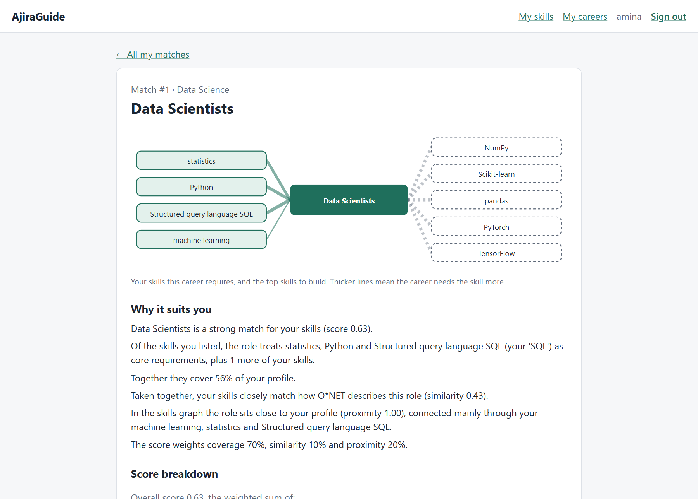
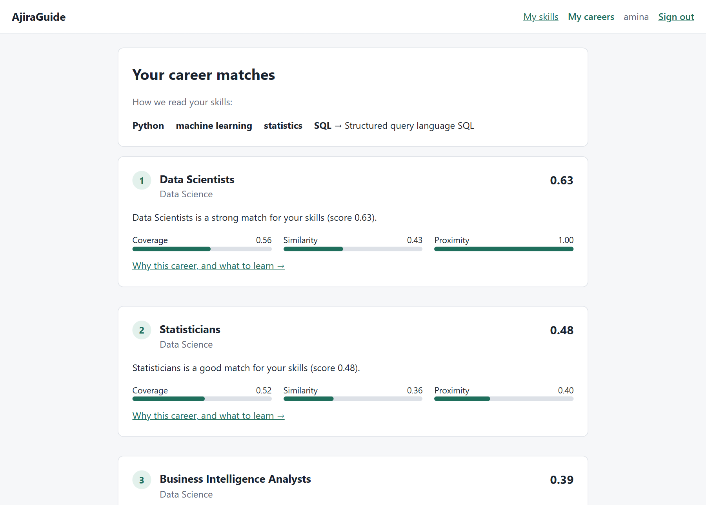
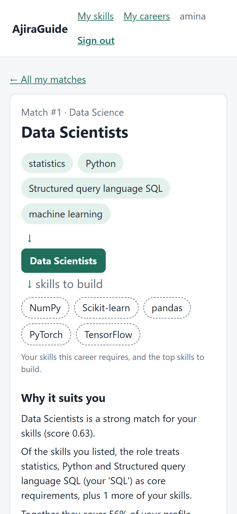
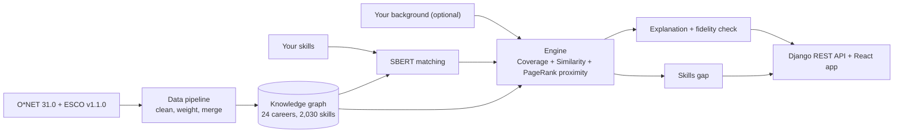

# AjiraGuide

**Explainable career guidance for tech roles.** Enter the skills you have, in
your own words, and AjiraGuide recommends tech careers, explains each one in
plain language, and shows which skills to build next.

**Live app:** https://explainable-career-kg-recommender.vercel.app ·
[User guide](frontend/public/help.html) · [Deployment](docs/deployment.md)



It combines a **knowledge graph** of 24 tech careers and 2,030 skills, built
from O*NET 31.0 and ESCO v1.1.0, with **SBERT** semantic matching, so
"talking to customers" finds *communicate with customers* and "JS" finds
*JavaScript*. Every explanation is generated only from the parts of the score
it describes, and a fidelity check confirms that in code.

| Your career matches | On a phone |
|---|---|
|  |  |

## Features

- **Skills in your own words**, matched by meaning, with uncertain matches flagged rather than hidden
- **Optional background**: education, field of study, career interests and experience also count towards matches
- **Explained recommendations**: a plain-language reason, the full explanation, the score breakdown and a skills-graph diagram
- **Skills gap and roadmap**: what each career needs that you have not listed, as a checklist you can track
- **Explore, saved careers and history**: every career, bookmarks, and a snapshot of your matches each time your profile changes
- **Accounts**: username and password or Google sign-in; change your details or delete everything in Settings
- **Administration**: user management, a read-only data catalogue and a system report at `/admin/`

## Results

Mean reciprocal rank of the correct career on held-out profiles
([full report](docs/testing_and_evaluation_report.md)):

| Profiles | Keyword baseline | AjiraGuide |
|---|---|---|
| 2 skills, clean wording | 0.349 | **0.528** |
| 2 skills, wording the system has never seen | 0.132 | **0.552** |
| All test profiles, clean wording | 0.429 | **0.620** |
| All test profiles, unseen wording | 0.208 | **0.599** |

Adding a background that describes the right career raises test MRR to 0.812
(clean wording) and 0.741 (unseen wording); a misleading background costs
about 0.05 ([background-test](data/results/background-test/background.csv)).
On everyday-language profiles, ranking by similarity to career descriptions
alone still does better than the full system; the report discusses why.

1,798 of 1,798 explanations pass the fidelity check; their mean reading level
is grade 9.7.

## How it works



| Folder | Contents |
|---|---|
| `backend/pipeline/` | Downloads O*NET and ESCO, cleans and weights them, merges duplicate skills |
| `backend/recommender/` | Knowledge graph, matching, scoring, explanations, fidelity, skills gap, evaluation |
| `backend/core/` | Django REST API and admin site: accounts, profiles, recommendations, history, report |
| `frontend/` | React app (Vite) |
| `data/processed/` | The cleaned dataset, versioned with the code |
| `docs/` | Evaluation report and protocol, explainability rubric, volunteer rating kit, deployment guide |

## Prerequisites

- Python 3.11
- Node.js 22.12 or newer
- PostgreSQL 18 (any recent version works)

## Backend

1. Create the database (you will be asked for the `postgres` user's password):

   ```bash
   psql -U postgres -h localhost -c "CREATE DATABASE ajiraguide"
   ```

2. Create a virtual environment and install the pinned dependencies:

   ```bash
   cd backend
   python -m venv .venv
   .venv\Scripts\activate        # macOS/Linux: source .venv/bin/activate
   pip install -r requirements.txt
   ```

3. Copy `.env.example` to `.env` and fill in real values. Generate a secret key with:

   ```bash
   python -c "from django.core.management.utils import get_random_secret_key as k; print(k())"
   ```

   If PostgreSQL is not on the default port 5432, set `DB_PORT` to match.

4. Apply migrations and start the server:

   ```bash
   python manage.py migrate
   python manage.py runserver --noreload
   ```

   The server runs at http://127.0.0.1:8000/.

## Dataset

The processed dataset in `data/processed/` is committed, so nothing needs to be
downloaded to use it. To inspect one occupation (from `backend/`, with the
virtual environment active):

```bash
python -m pipeline.summary "Data Scientists"
```

To rebuild it from the original sources, run the pipeline steps in order:

```bash
python -m pipeline.download     # O*NET 31.0, ESCO v1.1.0, crosswalk -> data/raw/ (checksums verified)
python -m pipeline.onet         # occupations, rated skills and tools
python -m pipeline.esco         # ESCO skills linked through the crosswalk
python -m pipeline.embeddings   # skill label embeddings -> data/cache/ (first run downloads the model)
python -m pipeline.mapping      # which ESCO skills are the same as an O*NET skill
```

| File | Contents |
|---|---|
| `occupations.csv` | The 24 in-scope tech occupations and their domain |
| `onet_skills.csv` | Essential, Transferable and Knowledge ratings; importance and level on 0-1 |
| `onet_tools.csv` | Software tools, weighted 1.0 In Demand / 0.75 Hot Technology / 0.5 other |
| `esco_occupations.csv` | ESCO occupations linked through the ESCO-O*NET crosswalk |
| `esco_occupation_skills.csv` | ESCO skills per occupation, weighted by how consistently they are required |
| `esco_skills.csv` | ESCO skill labels, types and alternative labels |
| `esco_onet_map.csv` | Each ESCO skill's closest O*NET skill; `merged` when similarity is at least 0.90 or the pair is in the hand-checked list in `mapping.py` |

O*NET is licensed under CC BY 4.0 by the U.S. Department of Labor, Employment and
Training Administration. ESCO is published by the European Commission.

## Recommender

`backend/recommender/` loads the dataset into an in-memory knowledge graph of
careers and the skills they require, matches a user's skills to it with SBERT,
and ranks careers by a weighted sum of Coverage, ProfileSimilarity and
GraphProximity (defined in `recommender/engine.py`). Each recommendation comes
with a plain-language explanation and the skills to build. From `backend/`:

```bash
python -m recommender Python "machine learning" statistics             # explained top 3
python -m recommender Python "machine learning" statistics --baseline  # keyword baseline
```

The first run downloads the SBERT model; after that, loading takes about 20
seconds and a ranking well under a second.

| Command | Purpose |
|---|---|
| `python -m pytest` | Run the tests |
| `python -m recommender.tuning --run NAME` | Grid search that chose the engine's parameters (about 3 minutes; writes `data/results/NAME/tuning.csv`) |
| `python -m recommender.fidelity` | Check that explanations only state what the score used |
| `python -m recommender.explanation_quality --run NAME` | Score explanations for completeness and readability (`docs/explainability_rubric.md`) |
| `python -m recommender.validate --run NAME` | Validation metrics and regression probes (never loads a test set) |
| `python -m recommender.evaluate --run NAME` | Final evaluation on the test sets (needs a clean, committed working tree) |
| `python -m recommender.background_eval --run NAME [--test]` | Choose and report the weight of the profile background |
| `python -m recommender.rating_kit sheet\|summarise --run NAME` | Volunteer rating sheet and results (`docs/volunteer_rating_kit.md`) |

## Frontend

```bash
cd frontend
npm install
npm run dev
```

The app runs at http://localhost:5173/.

## Running the web app

Start both apps, each in its own terminal, after the setup steps above:

```bash
# terminal 1, in backend/ with the virtual environment active
python manage.py runserver --noreload

# terminal 2, in frontend/
npm run dev
```

Django loads the knowledge graph and the SBERT model when it starts, so wait
for "Starting development server" (about 20 seconds) before using the app. Use
`--noreload`: Django's auto-reloader checks every loaded module for changes each
second, and once the model libraries are loaded that slows startup to several
minutes. Restart the server yourself after changing backend code. Then
open http://localhost:5173/, create an account, list your skills and choose
**Save and see my careers**. Each career links to its explanation and the
skills you would need to build.

In development Vite forwards `/api` requests to Django on port 8000. If that
port is taken, run Django on another one and tell Vite where it is:

```bash
python manage.py runserver 8010 --noreload           # backend
API_PROXY_TARGET=http://127.0.0.1:8010 npm run dev   # frontend (PowerShell: $env:API_PROXY_TARGET="http://127.0.0.1:8010"; npm run dev)
```

The API, under `/api/`, needs a token from register or login on every other
endpoint:

| Endpoint | Purpose |
|---|---|
| `POST auth/register/`, `POST auth/login/`, `POST auth/logout/`, `GET auth/me/` | Accounts and tokens |
| `PATCH`, `DELETE auth/me/`, `POST auth/password/`, `POST auth/google/` | Account details, deletion, password, Google sign-in |
| `GET`, `PUT profile/` | The signed-in user's skills and optional background (a save changes only the fields it sends) |
| `GET recommendations/?top=N` | Ranked careers with score components |
| `GET recommendations/<career code>/` | One career's explanation, contributing skills and skills gap |
| `GET careers/`, `GET careers/<career code>/` | Every career, with the user's match where there is one |
| `GET skills/?q=` | Skill names to suggest while typing |
| `GET`, `PUT saved/`, `saved/<career code>/` | Saved careers |
| `GET`, `PUT progress/` | Roadmap progress per skill |
| `GET history/`, `GET history/<id>/` | Recommendation snapshots |

## Deployment and administration

The frontend is on Vercel and the API on Azure Container Apps with a Neon
Postgres database; [docs/deployment.md](docs/deployment.md) has the steps,
including how to create the first administrator. The admin site at
`<API address>/admin/` manages users, shows the careers and skills, and has a
system report.

Access to it is by role (`backend/core/roles.py`). An **Admin** manages student
accounts and their data and reads the report and catalogue. A **Superadmin**
can also assign roles, edit staff accounts and delete users. A Superadmin sets
roles on a user's page, or from the command line:

```bash
python manage.py assign_role <username> superadmin   # or admin, or none
```
